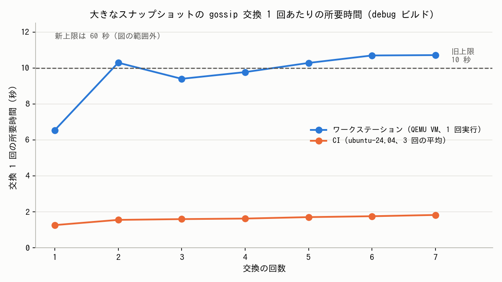

# gossip の大きなスナップショット交換テストの制限時間を緩める

- **実施日時**: 2026年11月1日 22:10 〜 2026年11月2日 01:02 JST (issue #44 の解説、交換 1 回の所要時間をワークステーションと CI で計測、テストの制限時間を 10 秒から 60 秒に緩める修正)
- **報告日時**: 2026年11月2日 01:02 JST
- **作成者**: Claude Opus 5.5

## 概要

`mesh-llm-host-runtime` に、大きな gossip のスナップショットを本物の QUIC 接続で交換できるかを確かめるテストがあります。このテストが、ワークステーションでだけ毎回失敗していました（issue #44）。CI では通ります。このテストは、gossip の交換を何回か繰り返し、1 回ごとに 10 秒の制限時間を設けています。ワークステーションでは、その制限時間を超えていました。

原因を確かめるため、交換の各段階に時刻を出力するコードを一時的に足して、ワークステーションと CI の両方で測りました。どちらの環境でも、交換は 7 回で、1 回に届く量も同じでした。違うのは速さだけで、交換 1 回がワークステーションでは約 10 秒、CI では約 1.5 秒でした。ワークステーションでは、7 回のうち 4 回が 10 秒を超えていました。

はじめは、ワークステーションの仮想 CPU に、暗号処理を速くする命令（`pclmulqdq`）が無いことが原因だと推測していました。ところが、処理ごとに比べると、暗号と関係のないフレームの組み立てやデータの解析も、同じように 3〜8 倍遅くなっていました。ですから、特定の命令が無いことではなく、ワークステーションの CPU が全体的に遅いことが原因です。コードの不具合ではありません。

そこで、テストの交換 1 回あたりの制限時間を、10 秒から 60 秒に緩めました。この制限時間は、交換が止まってしまったことを見つけるためのもので、速さを測るためのものではありません。60 秒にしても、止まってしまった交換は見つけられます。CI では交換 1 回が 2 秒弱なので、CI での結果は変わりません。修正後、ワークステーションでもテストが通ることを確かめました。

本番のコードは変えていません。変えたのはテストの制限時間と、その理由を書いたコメントだけです。

## 添付ファイル

- [ワークステーションでの計測ログ（時刻出力付き、1 回実行）](attachment/2026-11-02_004646_issue44_gossip_exchange_timeout/workstation_run.log)
- [CI での計測ログ（CPU 情報と時刻出力、3 回実行）](attachment/2026-11-02_004646_issue44_gossip_exchange_timeout/ci_run.log)
- [グラフを作ったスクリプト](attachment/2026-11-02_004646_issue44_gossip_exchange_timeout/plot.py)

## 核心発見サマリ



**結論**: 交換 1 回の所要時間は、ワークステーションで 6.54〜10.71 秒（7 回中 4 回が 10 秒超え）、CI で 1.25〜1.89 秒（3 回実行、すべて 2 秒未満）でした。どちらも交換は 7 回で、1 回に届く署名付きの情報は 13 個です。処理ごとの倍率は 2.7〜8 倍で、暗号と関係のない処理も同じように遅いので、原因は CPU 全体の遅さです。交換 1 回あたりの制限時間を 60 秒にしました。ワークステーションの最大値（10.71 秒）に対して約 5.6 倍、CI の最大値（1.89 秒）に対して約 32 倍の余裕があります。

## 前提・目的

- **背景**: issue #44。`mesh::gossip::tests::signed_records::bounded_exchange::oversized_snapshots_complete_real_quic_exchanges_in_both_directions` がワークステーションでだけ `Elapsed(())` で失敗する。#15 の修正（PR #39）を検証したときに見つかった。修正前のコードでも同じように失敗する
- **目的**: 交換 1 回の所要時間を測って原因を確かめ、ワークステーションでもテストが通るようにする
- **テストの中身**: 送信側に、約 100KB の署名付き情報（signed record）を 90 個分持たせる。合計は 8MiB を超える。これを、ループバックの QUIC 接続で、gossip の交換を繰り返して受信側へ届ける。1 回の交換で送れるフレームは `MAX_CONTROL_FRAME_BYTES`（8MiB）までで、`GossipFrameEncoder` が origin ごとに切り分けて続きを次回に回す。追加したのは upstream の Mesh-LLM/mesh-llm#2647

## 環境情報

| | ワークステーション | CI |
|---|---|---|
| CPU | QEMU Virtual CPU version 2.5+（32 vCPU、2.1 GHz） | AMD EPYC 7763（4 vCPU） |
| `pclmulqdq` / `vaes` / `sha_ni` / `adx` | なし（`aes`、`avx2`、`avx512f` はあり） | すべてあり |
| ランナー | — | GitHub-hosted `ubuntu-24.04` |
| ビルド | debug（`dev` profile）、rustc 1.99.1 | debug、`dtolnay/rust-toolchain` の stable pin（fork-ci.yml と同じ） |
| 計測したコード | `origin/main` `35a64ce76` に時刻出力を足したもの | 同じ |

- 修正のブランチ: `fix/issue44-gossip-exchange-timeout`（`origin/main` `224b0d71f` から作成）

## 再現方法

### 計測

一時的な worktree で、次の 3 つのファイルに `eprintln!("[T44] …")` で経過時間を出力するコードを足し、テストの制限時間を 600 秒に広げて `--nocapture` で実行しました。計測用のコードはコミットせずに消しています（CI での計測には、一時的なブランチ `measure/issue44` と、そのブランチへの push でだけ動く workflow を使い、計測後に消しました）。

- `mesh/crates/mesh-llm-host-runtime/src/mesh/gossip.rs`: 送信側の `gossip_round_trip`、受信側の `handle_gossip_stream`
- `mesh/crates/mesh-llm-host-runtime/src/protocol/mod.rs`: `write_gossip_payload`（エンコードと書き込み）
- `mesh/crates/mesh-llm-host-runtime/src/mesh/tests/gossip/bounded_exchange.rs`: 交換 1 回ごとの合計時間と、届いた数

CI の実行: https://github.com/miminashi/mesh-llm/actions/runs/41316706854

### 修正の確認

```bash
export PATH=$HOME/.rustup/toolchains/stable-x86_64-unknown-linux-gnu/lib/rustlib/x86_64-unknown-linux-gnu/bin/gcc-ld:$PATH
export RUSTC_WRAPPER= CARGO_TARGET_DIR=/home/ubuntu/projects/mesh-llm/target
cargo test -j 8 -p mesh-llm-host-runtime --lib -- oversized_snapshots_complete_real_quic_exchanges_in_both_directions
```

## 結果詳細

### 交換ごとの所要時間

| 回 | ワークステーション | CI 1 回目 | CI 2 回目 | CI 3 回目 | 届いた数（90 個中） |
|---|---|---|---|---|---|
| 1 | 6.54 秒 | 1.26 秒 | 1.28 秒 | 1.25 秒 | 13 |
| 2 | **10.29 秒** | 1.56 秒 | 1.56 秒 | 1.54 秒 | 26 |
| 3 | 9.40 秒 | 1.59 秒 | 1.61 秒 | 1.59 秒 | 39 |
| 4 | 9.77 秒 | 1.61 秒 | 1.65 秒 | 1.62 秒 | 52 |
| 5 | **10.28 秒** | 1.73 秒 | 1.71 秒 | 1.68 秒 | 65 |
| 6 | **10.69 秒** | 1.78 秒 | 1.75 秒 | 1.74 秒 | 78 |
| 7 | **10.71 秒** | 1.89 秒 | 1.79 秒 | 1.80 秒 | 90 |
| テスト全体 | 73 秒 | 12.96 秒 | 12.89 秒 | 12.72 秒 | |

太字は旧上限の 10 秒を超えた回です。

### 交換 1 回の内訳（3 回目の交換）

| 処理 | ワークステーション | CI | 倍率 |
|---|---|---|---|
| 送るフレームの組み立て（`build_gossip_frame` など。計測点の差からの推定） | 約 3.0 秒 | 約 0.43 秒 | 約 7 倍 |
| protobuf へのエンコード | 0.19 秒 | 0.04 秒 | 約 4.5 倍 |
| QUIC での約 8MiB の転送（片道） | 約 1.5 秒 | 約 0.26 秒 | 約 6 倍 |
| 受け取ったデータの解析（decode） | 約 0.5 秒 | 約 0.06 秒 | 約 8 倍 |
| 署名の検証と状態への取り込み（`resolve_inbound_gossip`） | 約 0.5 秒 | 約 0.2 秒 | 約 2.7 倍 |

### 修正後のワークステーションでのテスト

修正後のコード（制限時間 60 秒、時刻出力なし）で、ワークステーションで 3 回続けて実行し、3 回とも通りました。

| 実行 | 結果 | テスト全体の時間 |
|---|---|---|
| 1 | ok | 70.86 秒 |
| 2 | ok | 69.72 秒 |
| 3 | ok | 69.01 秒 |

`cargo fmt` 相当の確認（`rustfmt --check --edition 2024`）も通りました。clippy は手元では回さず、PR の CI（Clippy and tests）に任せました。

## 副次発見

- **交換の回数が、見込みよりずっと多い。** フレームは毎回 8MiB の上限いっぱい（約 8,074,000 バイト）だが、入る署名付きの情報は 14〜15 個だけ。残りは、互換用の announcement でモデルの説明を展開した分で埋まっている。テストのコメントにある「Compatibility announcements expand model descriptions」のとおりで、そのためテストは毎回の進捗だけを確かめている
- **2 回目からは、返事でも約 8MiB が送り返される。** 受信側が、受け取った情報を送信側に送り返すため（テスト名の "in both directions"）。交換 1 回で 8MiB の転送が往復 2 回起きる
- upstream にも、テストの時間上限を「負荷の高いマシンでも通るように」広げた前例がある（Mesh-LLM/mesh-llm#2705、`test(stage): give the readiness probe shutdown test room on a busy machine`）。upstream と jimoto-no-llm/mesh-llm には、このテストについての報告や修正案は無かった（2026-11-01 時点）

## 残課題

- ワークステーションの CPU が CI より 3〜8 倍遅い理由（ホストの CPU の世代、ホストへの詰め込み具合など）は、VM の中からは分からない。ほかの時間に厳しいテストでも、同じようにワークステーションでだけ失敗することがありうる
- 同じ修正を upstream に提案するかどうかは決めていない（この fork は自分たち用で、upstream 向けではない）
